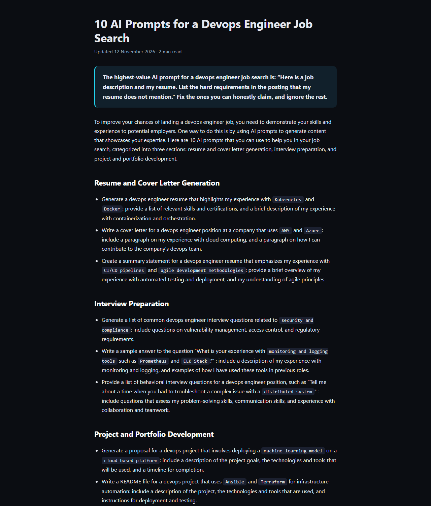
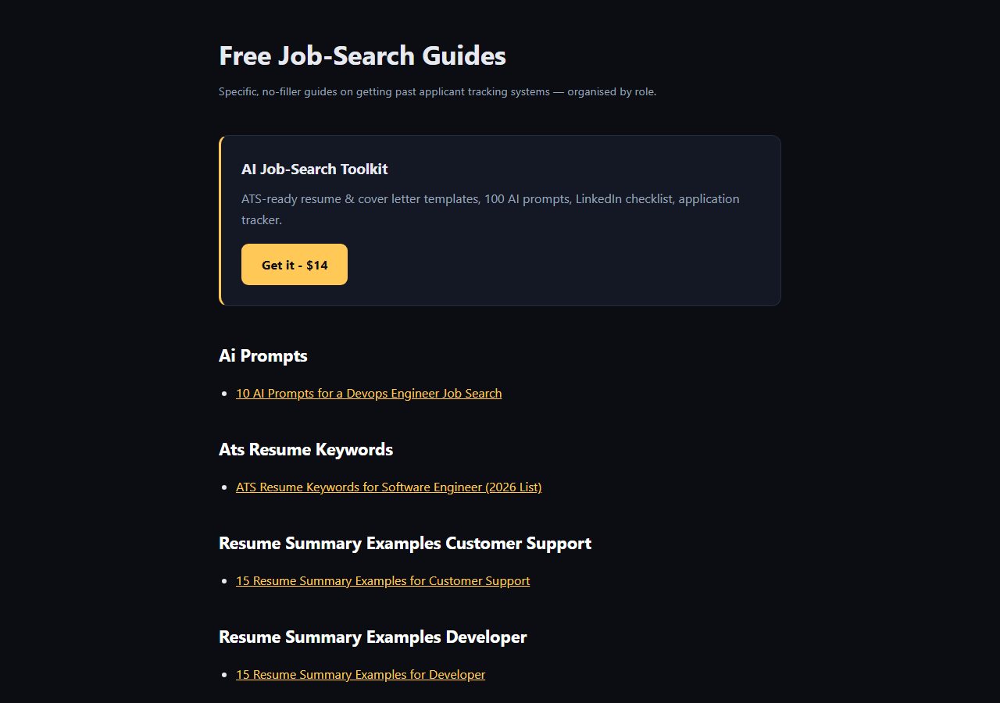
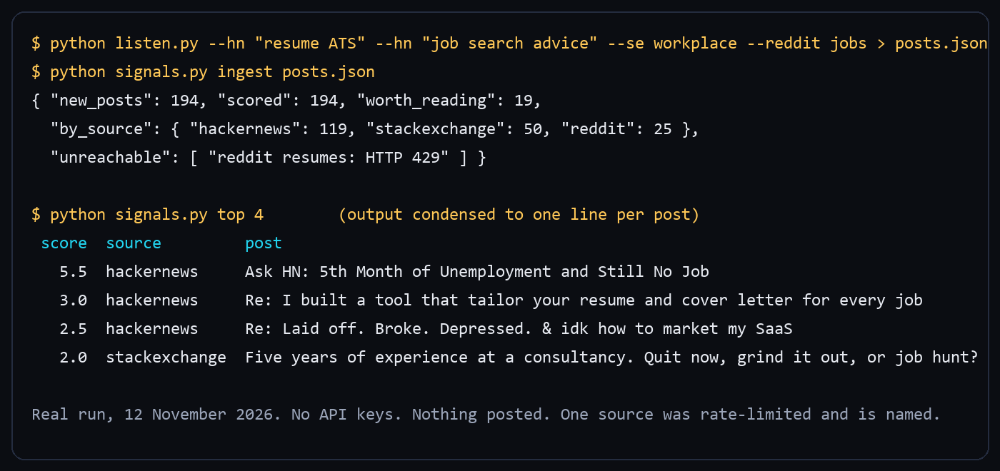

# Aether Engine

Find people publicly asking for what you sell, rank them by buying intent, plan
pages from real keyword data, and publish long-tail SEO pages that link to your
checkout. Pure Python standard library. No API keys required.

```
LISTEN ──► RANK ──► PLAN ──► WRITE ──► PUBLISH ──► AUDIT
 public    intent   keyword   you or    schema,     measured
 posts     model    data      your      links,      from the
                              agent     sitemap     files
```

| A published page | The generated index |
|---|---|
|  |  |

## What it does

- **Listens** to Hacker News, Reddit, StackExchange and any RSS feed through
  public, read-only endpoints. It never logs in and never posts.
- **Ranks by buying intent** with phrase rules from your profile, then with a
  Naive Bayes model that learns from the reply drafts you approve or reject. The
  model stays silent until it has 20 decisions and reports its own
  cross-validated accuracy.
- **Plans pages from keyword data** you import (a DataForSEO response, or a
  Semrush, Ahrefs or Search Console export). Near-duplicates become one topic.
  A number that was not imported is shown as unknown, never estimated.
- **Publishes** static pages with Article, FAQ and breadcrumb structured data,
  an answer box, related links, an index, `sitemap.xml` and `robots.txt`. Pages
  are rendered at publish time against the whole site, so no page is left
  without inbound links.
- **Audits the files on disk**: titles, descriptions, canonicals, structured
  data, thin pages, broken links, orphans, sitemap coverage.
- **Tags every buy link** with the page it sits on, so your checkout analytics
  show which page earned each sale.

## Quick start

Python 3.10+. Nothing to install.

```bash
git clone https://github.com/AbdullahRathoreVA/aether-engine
```

```bash
cd my-project && python ../aether-engine/aether.py init
```

Fill in `aether.json` (what you sell, the phrases your buyers use, where to
listen). [`examples/job-search-toolkit.json`](examples/job-search-toolkit.json)
is a complete worked profile. Then:

```bash
python ../aether-engine/aether.py status
```

The folder you run it from is the workspace: `aether.json`, `.aether/` (state)
and `site/` (output) stay there.

## Commands

Every command prints JSON on stdout and exits non-zero on failure.

| Command | What it does |
|---|---|
| `init` / `status` | create a starter profile / check it and show counts |
| `harvest` | pull new posts; reports what arrived and what was unreachable |
| `score` / `top [n]` / `questions [n]` | rank posts; show the best; show the questions people asked |
| `keywords import <file>` / `add` / `list` | load keyword data |
| `plan [n]` / `brief <id>` | ranked page topics / a writing brief for one |
| `page add <file>` / `list` / `remove <slug>` | store a page (quality gate, sanitised) |
| `seo [n]` | build matrix pages from profile templates (needs an LLM key or template text) |
| `publish` / `audit` | render everything / measure what was written |
| `draft add` / `queue` / `approve` / `reject` / `posted` | reply drafts behind a human decision |
| `train` / `report` | what the model learned / write `aether-report.md` |

## The daemon and dashboard

`python -m engine.main` runs the same pipeline unattended with a live dashboard
at `http://127.0.0.1:7717`. Optional LLM backends write drafts and matrix
pages: Claude (`ANTHROPIC_API_KEY`, hard daily spend cap `ANTHROPIC_DAILY_USD`),
Groq, or local Ollama. A backend that fails three times running is benched for
ten minutes. With no backend, nothing is written rather than filler. Copy
`.env.example` to `.env` to configure.

## Boundaries

- Reply drafts are never posted. A person approves, copies and posts.
- Harvested text is third-party content: stored and shown as data, never acted on.
- Page bodies are reduced to an allowlist of harmless tags before storage.
- Only `http(s)` URLs are fetched; responses are size-capped.
- Rankings, traffic and sales are not guaranteed by this or any tool.

## Tests

```bash
python -m unittest discover -s tests
```

39 tests, standard library only, no network.

## Packaged edition for AI agents

The Agensi marketplace carries a packaged edition that an agent (Claude Code,
Codex CLI, Cursor and similar) loads on demand, with nothing to install:

| Listing | What is inside |
|---|---|
| **Aether Listen** (free) | find and rank the people asking for what you sell |
| **Aether Engine** (paid) | three skills in one purchase: the SEO pipeline above; **Agent Team**, which runs several AI agents through one Git repo with handoff messages, an inbox per agent, claim and done, and a status board; and **Aether Proof**, which checks a draft for filler, stock phrases and over-long sentences before it goes out |



Both are on the creator page: <https://www.agensi.io/creators/abdullah-rathore>.
Every script in that edition is one standalone standard-library file; the only
one that uses the network reads no files, and nothing is ever posted for you.

## Licence

Copyright (c) 2026 Abdullah Rathore. All rights reserved. The source is public
for evaluation; see [LICENSE](LICENSE). The packaged edition is distributed through the Agensi marketplace.
